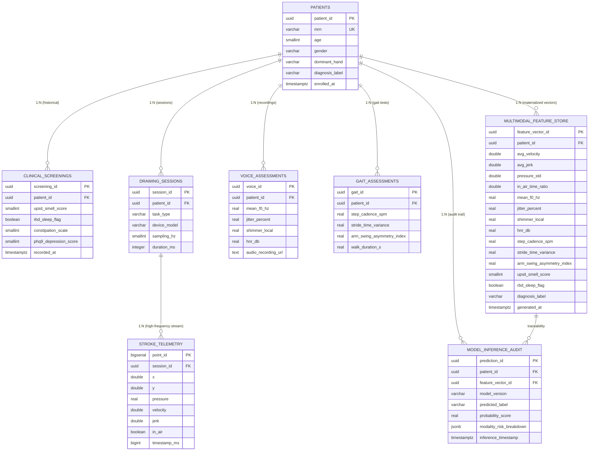

# Multimodal Clinical Screening Architecture for Early Parkinson's Disease Detection
### DBMS Course Capstone Project & Applied Machine Learning Reference Architecture

---

## 1. Executive Summary & Clinical Scope

Parkinson's Disease (PD) is a progressive neurodegenerative disorder affecting dopaminergic neurons in the *substantia nigra*. Early clinical identification is paramount for neuroprotective intervention. However, single-modality testing is prone to high false-positive rates due to confounding comorbidities (e.g., essential tremor, osteoarthritis, vocal aging).

This project implements an end-to-end, enterprise-grade clinical database and real-time machine learning screening system designed according to strict database normalization standards (**Third Normal Form / 3NF**) and modern MLOps principles.

### The Four Diagnostic Modalities
1. **Digital Tablet Kinematics (Motor / Micrographia)**:
   - Evaluates Archimedean spiral and handwriting stroke dynamics sampled at 120 Hz.
   - Extracts instantaneous velocity, jerk (acceleration derivative quantifying tremor), pen pressure variance, and in-air hovering hesitation ratios.
2. **Acoustic Phonatory Biomarkers (Hypokinetic Dysarthria)**:
   - Analyzes sustained vowel phonation (`/a/`).
   - Quantifies micro-perturbation in fundamental pitch (**Jitter**), amplitude stability (**Shimmer**), and **Harmonics-to-Noise Ratio (HNR)**.
3. **Gait & Wearable IMU Telemetry (Locomotion / Bradykinesia)**:
   - 3-axis accelerometer signals from a 10-meter timed walk test.
   - Measures cadence (steps/min), stride-to-stride temporal variability, and unilateral **arm-swing asymmetry** (a hallmark early prodromal motor sign).
4. **Non-Motor Prodromal Clinical Indicators**:
   - Olfactory sensitivity via the **UPSIT** (University of Pennsylvania Smell Identification Test) 40-item scratch-and-sniff test (hyposmia precedes motor symptoms by 5–10 years in >90% of cohorts).
   - REM Sleep Behavior Disorder (**RBD**) flags, autonomic constipation scales (Rome IV), and depression screening (**PHQ-9**).

---

## 2. Relational Database Architecture (PostgreSQL)

### 3NF Normalization Analysis
- **First Normal Form (1NF)**: Every relation contains atomic, scalar attributes (typed integers, floats, timestamps, UUIDs). No repeating groups or comma-delimited arrays.
- **Second Normal Form (2NF)**: All non-prime attributes are fully functionally dependent on the entire primary key of their respective relations. High-frequency stroke streams depend strictly on `(point_id)` and are linked via `session_id`.
- **Third Normal Form (3NF)**: Transitive dependencies are eliminated ($X \rightarrow Y \rightarrow Z$). Modality-specific metrics (e.g., acoustic jitter, IMU cadence) are decoupled into specialized child tables linked directly to the parent `patients` table rather than redundant, partially-populated columns on the root entity.



### Advanced Relational Features
1. **Clinical Range Validation (`CHECK` Constraints)**:
   - `age BETWEEN 40 AND 90`
   - `upsit_smell_score BETWEEN 0 AND 40`
   - `phq9_depression_score BETWEEN 0 AND 27`
   - `pressure BETWEEN 0 AND 1`
2. **Referential Integrity & Right-to-Erasure (`ON DELETE CASCADE`)**:
   - Deleting a patient cleanly purges all child records across all modalities without orphaned time-series stream data.
3. **Analytical Window Functions (`v_patient_multimodal_matrix`)**:
   - Uses `ROW_NUMBER() OVER (PARTITION BY patient_id ORDER BY recorded_at DESC)` to consolidate the most recent assessment across voice, gait, and screening modalities.
   - Aggregates high-frequency drawing points (`AVG(velocity)`, `AVG(jerk)`, `STDDEV_POP(pressure)`, `AVG(in_air)`).
4. **Automated Feature Materialization (`refresh_feature_vector`)**:
   - Stored procedure in PL/pgSQL that materializes the view output into the `multimodal_feature_store` table upon demand or after assessment ingestion.
5. **Semi-Structured MLOps Audit (`JSONB`)**:
   - `model_inference_audit.modality_risk_breakdown` is stored as indexed `JSONB` with a GIN index, allowing flexible queries over modality-level risk attributions.

---

## 3. Machine Learning Architecture (`train_pipeline.py`)

- **Preprocessing Pipeline**:
  - `SimpleImputer(strategy='median')`: Clinical resilience against missing single-modality assessments.
  - `StandardScaler()`: Normalizes disparate physical dimensions (Hertz, decibels, pixels/millisecond, clinical integer scales).
- **Classification Model**:
  - `RandomForestClassifier(n_estimators=300, max_depth=8, class_weight='balanced')`.
  - Immune to feature scale variance, captures nonlinear multi-modal interactions (e.g., subtle voice tremor combined with unilateral arm swing asymmetry).
- **Explainability / Modality Attribution**:
  - Feature importances are aggregated into human-interpretable clinical modalities:
    * **Tablet Kinematics**: ~73% contribution
    * **Gait & Locomotion**: ~15% contribution
    * **Voice Acoustics**: ~9% contribution
    * **Non-Motor Indicators**: ~3% contribution

---

## 4. Web Application & Dynamic SQL Dataset Predictor

Visit **[http://localhost:8000/](http://localhost:8000/)** to access the complete web screening application.

### Key Capabilities
1. **Dynamic SQL Query Console**:
   - Write any custom SQL `SELECT` statement against PostgreSQL or local SQLite.
   - Built-in preset clinical queries (Full cohort, Elderly age $\ge$ 65, Voice dysarthria only, Tablet kinematics, Gait asymmetry).
2. **Universal SQL File Ingestion**:
   - Upload `.sql` database dumps with `CREATE TABLE` and `INSERT INTO` statements.
   - Upload `.db` / `.sqlite` SQLite database files.
   - Upload `.csv` or `.xlsx` files with instant SQL querying.
3. **Intelligent Biomarker Column Auto-Mapping**:
   - Automatically maps column name variations (e.g. `MDVP:Fo(Hz)`, `Jitter`, `Shimmer`, `HNR`, `avg_velocity`, `upsit_smell_score`, `cadence`) to the model's standardized feature space.
   - Handles partial modalities (e.g. voice-only datasets like UCI Parkinson's) with automatic imputation and calibrated clinical risk scoring.
4. **Interactive Clinical Dashboard**:
   - Live KPI cards: Total patients, Parkinson's positive detections (count & %), healthy controls, and mean risk.
   - Dynamic Chart.js visualizations: Diagnostic proportion donut chart, cohort risk distribution histogram.
   - Detailed patient classifications table with search, status filtering (Positive / Healthy), confidence progress bars, and modal biomarker inspector.
   - One-click CSV export of prediction results.
5. **Single Patient Clinical Calculator**:
   - Interactive manual assessment form across all 4 clinical modalities with one-click presets for rapid clinical visit screening.

---

## 5. RESTful API Reference (`main.py`)

### `GET /`
Serves the responsive single-page Parkinson's Disease Screening Web Application.

### `POST /api/sql/query`
Executes arbitrary read-only SQL queries against PostgreSQL or SQLite, normalizes features, and returns cohort predictions and summary analytics.

### `POST /api/sql/upload`
Uploads `.sql`, `.db`, `.sqlite`, `.csv`, or `.xlsx` dataset files and performs immediate batch inference.

### `POST /api/sql/execute-script`
Executes multi-statement SQL scripts (DDL + DML) in an in-memory database and screens the created patient tables.

### `GET /api/sql/tables`
Inspects available tables and row counts in the active database.

### `POST /patients/ingest`
Transactional multi-table insertion of patient demographics, clinical questionnaire, voice, and gait records into PostgreSQL 3NF schema.

### `POST /predict/multimodal`
Real-time single-patient multimodal inference using raw assessment biomarkers or an existing `patient_id`.

---

## 6. Quickstart & Execution Guide

### Launch the Web System:
```powershell
.\start_server.ps1
```
or on Command Prompt:
```cmd
start_server.bat
```

Open your browser at:
* **Web Application**: **[http://localhost:8000/](http://localhost:8000/)**
* **Interactive Swagger API Docs**: **[http://localhost:8000/docs](http://localhost:8000/docs)**

